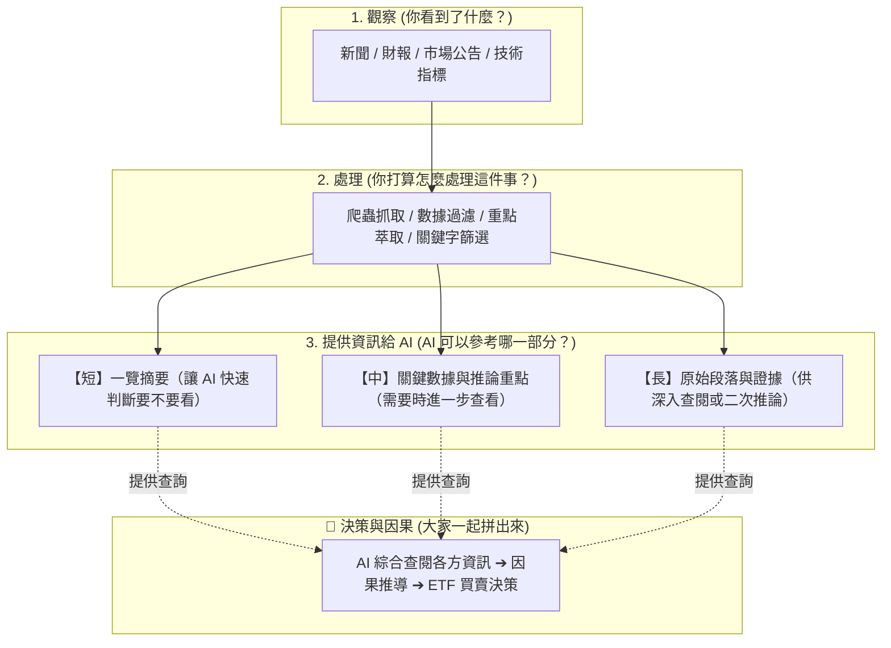

# ETF Agent — AI CUP 2026 (Team 32)  
備註以下由AI擴寫  並非是本人的口吻，請不要太過較真  意思有傳到就好啦!

這是一個**事件導向、因果與趨勢追蹤**的 ETF 經理人專案。目前技術暫定使用 LangGraph 搭建，目前是**草框**。

> **老實說：整條流程目前不能跑通。**  
> 整體的事件拼圖、AI 流程，大部分都需要大家一起來完善。這也是我們在會議中討論到的目標：先把架構共識定出來，再由大家各自分工補上自己的那一塊拼圖。

---

## 🤖 不知道怎麼開始？先複製這份「AI 助手提示詞」！

如果你腦中有想法，但不確定怎麼寫成架構，**不需要自己硬想！**  
我們準備了一份專門將「你的構想」轉化為「專案標準流程」的提示詞範本：

👉 **[點此查看／複製 AI 助手提示詞 (docs/PHILOSOPHY.md)](docs/PHILOSOPHY.md)**

只要把這份提示詞複製貼給 ChatGPT、Claude 或 Gemini，AI 就會成為你的「架構教練」：
1. 擔任你與專案設計語言（Lingua Franca）之間的轉譯橋樑。
2. 暫時**不需要寫出複雜的程式樣品**，而是引導你把思路理清楚。
3. 幫你直接**匯出一份符合規範的 Mermaid 流程圖**與【短/中/長】三層資訊格式。
4. 整理好後，你直接複製貼到專案的網頁上就能完成貢獻！

---

## 🗺️ 專案地圖 (Map)

大家不用去想整個系統有多複雜，核心其實就是這張圖與三個問題：

---

## 💡 組員分工指引：如何貢獻你的想法或程式碼？

你**完全不需要下載或執行整個專案**（不用擔心環境跑不起來，也不用擔心電腦出問題或有什麼風險）。  
你只需要根據你在會議上的想法，認領或提出一個「觀察項目」，例如：
* *「我想做財報分析，看看營收有沒有不如預期。」*
* *「我想做市場情緒指標，看新聞是偏多還是偏空。」*
* *「我有抓到即時新聞，想把重大事件挑出來。」*

當你準備好一段邏輯、一段文字提示詞、或者一個處理腳本時，請幫忙整理成這 **三個問題**：

### 1. 你今天看到了什麼東西？
* 資料來源是什麼？（例如：公開資訊觀測站的財報、Yahoo 新聞、某個指數）
* 這條資訊是在什麼時候發生的？

### 2. 你打算怎麼處理這個部分？
* 你打算用什麼方式處理？（例如：寫爬蟲、找關鍵字、算均線、還是請 AI 先做初階整理）
* **⚠️ 數值線重要提醒**：若處理的是量化數據、均線或技術指標，**不要直接把一大坨數字丟給 AI**（AI 沒辦法做跨數據的複雜觀察）。請將它包裝成「工具（Tool）」供 AI 依需呼叫，或預先加工成清晰的訊號摘要文字或趨勢說明！

### 3. 你覺得 AI 可以參考哪一個部分？（提供資訊）
為了不讓資訊一次塞太多把 AI 搞混，建議可以將整理後的資訊切成「三段（長、中、短）」，讓 AI 依照需求分層查閱：
* **短（概要）**：一句話講完重點（讓 AI 先掃過，決定要不要深入看）。
* **中（要點）**：具體的數字變化或核心理由（例如：營收年減 5%，低於市場預期）。
* **長（原文）**：保留原文段落或證據（如果 AI 覺得這件事超級重要，可以調閱原文做第二輪深思）。
* *註：你也可以只提供單純的重點資訊，或者「你覺得這有參考價值，但還不知道怎麼處理」，直接寫下來提出來討論也可以！*

---

## 📝 如何直接在 GitHub 上新增你的頁面？（免下載、免安裝）

為了讓大家最安全、最無負擔地協作，你**不需要把專案 clone 下來**，直接在 GitHub 網頁上操作即可：

1. 點擊進入專案的 `contributions/` 資料夾（或點擊[這裡可以直接新增檔案](../../new/main/contributions)）。
2. 點擊右上角的 **「Add file」➔「Create new file」**。
3. 檔名取一個好認的名字（例如：`news_sentiment_by_小明.md` 或 `earnings_parser.py`）。
4. 在內容中：
   * 可以直接用 Markdown 寫下你的**想法、邏輯規劃、或上述三步驟的內容**（也可以附上 AI 幫你產生的 Mermaid 流程圖！）。
   * 也可以直接貼上你寫好的 **Python 處理腳本或 Prompt 提示詞**。
5. 點擊右上角綠色的 **「Commit changes...」** 送出即可！

> 拼裝與整合交給我就好，我會負責把你提交的內容安全地串接到 LangGraph 流程中！

---

## 📂 我有寫 Python 腳本（例如財報萃取），要放哪裡？

先放在 `contributions/` 底下，**不用放進程式主體，也不用管怎麼接進流程**：

1. 在 `contributions/` 建立一個以主題命名的資料夾，例如 `contributions/earnings_report/`（網頁上新增檔案時，檔名輸入 `earnings_report/parser.py`，輸入斜線就會自動建立資料夾）。
2. 把你的 Python 腳本放進去。
3. 在同一個資料夾放一個說明檔 `README.md`，用上面的三個問題簡單寫清楚：你看到什麼（例如哪裡的財報）、怎麼處理（腳本萃取哪些欄位）、提供給 AI 的短／中／長資訊是什麼。
4. 腳本還沒寫完也可以先放，說明檔寫想法就行。

之後由我負責把它接進流程。
