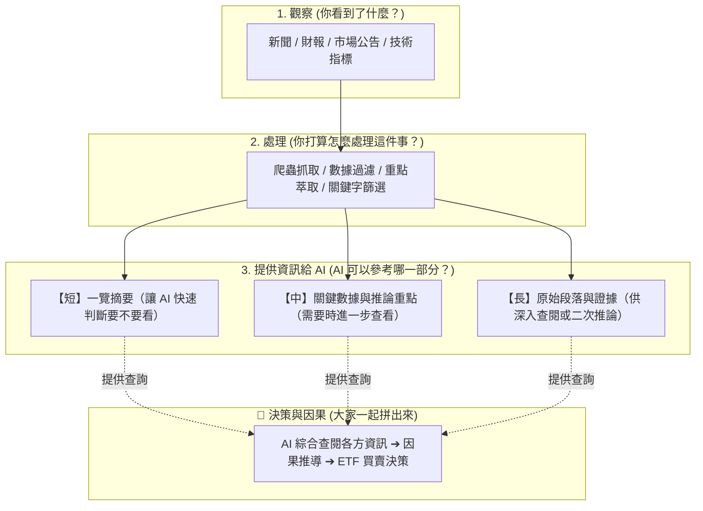

# 專案地圖 (Map)

這張地圖是我們討論的四個階段，大家隨時可以在 GitHub 上瀏覽：

---

## 貢獻方式（直接在網頁新增檔案即可）

請至 `contributions/` 資料夾，點選 **Add file ➔ Create new file**，回答這三個問題並留下你的想法或腳本：
1. **你看到了什麼？**
2. **你打算怎麼處理？**
3. **你覺得 AI 可以參考哪一部分？（短/中/長）**
