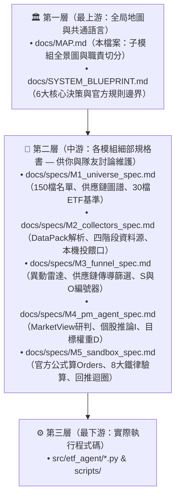
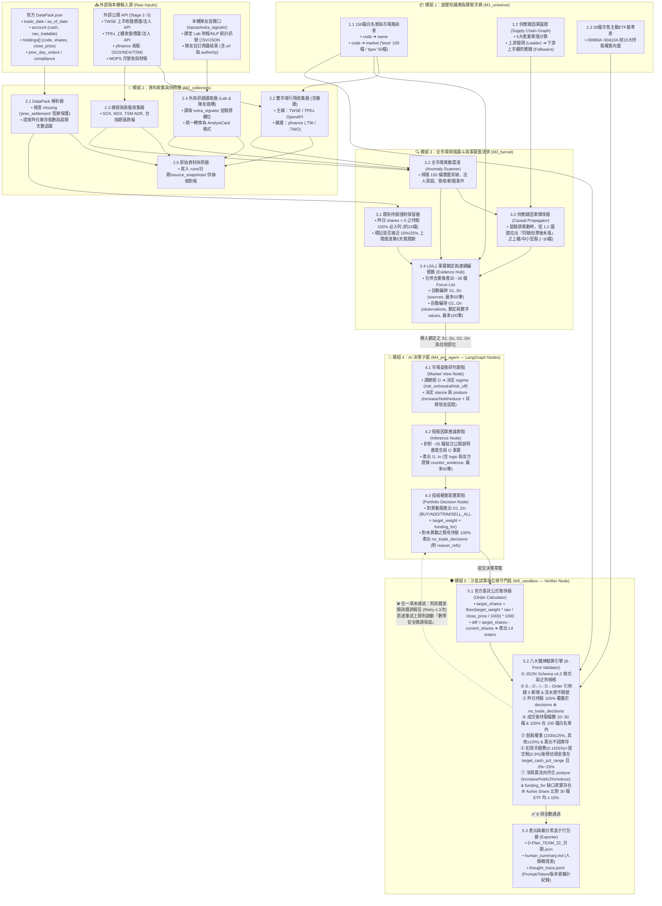

# 系統上游主幹與子模組詳細架構圖 (Master Architecture & Sub-module Map)

> **本文件的定位（程式碼的上游）**：  
> 這裡記錄我們與隊友討論出的**所有模組邊界、內部子模組、資料流向與待決議細節**。  
> 任何想法先在這裡（以及 `docs/specs/` 下的各模組規格檔）寫清楚、畫進圖裡，才往下游寫成程式碼。這樣就算過了幾天回來看，也不會忘記當時為什麼這樣設計。

---

## 一、三層式文件結構（從上游概念到下游程式）

---

## 二、全系統子模組展開詳圖（Detailed Sub-module Architecture）

這張圖把原本的 5 個大盒子徹底拆開，標示出**每一個內部子模組、傳遞的資料結構、以及 LangGraph 的回推條件邊（Conditional Edge）**：

---

## 三、五個模組的上游規格書索引（點進去查看或與隊友討論各模組細節）

為了避免「討論完就忘記」，我們把上面 5 個大區塊各自獨立成一份詳細的規格書（放在 `docs/specs/` 下）：

| 模組代號 | 上游規格書連結 | 裡面記錄了什麼細節？ | 適合哪位隊友一起看？ |
| :--- | :--- | :--- | :--- |
| **M1** | [`docs/specs/M1_universe_spec.md`](specs/M1_universe_spec.md) | 150 檔上市櫃分類規則、5 大供應鏈上下游對照表、30 檔 ETF Active Share 比對方法 | 負責產業研究／選股分類的隊友 |
| **M2** | [`docs/specs/M2_collectors_spec.md`](specs/M2_collectors_spec.md) | `DataPack` 異常處理、TWSE/TPEx/美股抓取欄位、課堂 Lab 與隊友爬蟲的 `AnalystCard` 投餵格式 | 負責寫財報腳本／新聞爬蟲／指標的隊友 |
| **M3** | [`docs/specs/M3_funnel_spec.md`](specs/M3_funnel_spec.md) | Day 1 與 Day 2~24 如何從 150 檔篩出 ~35 檔、異動雷達公式、`S` 與 `O` 的無幻覺編號規則 | 負責量化篩選／事件觸發條件的隊友 |
| **M4** | [`docs/specs/M4_pm_agent_spec.md`](specs/M4_pm_agent_spec.md) | LangGraph State 欄位定義、`market_view` 姿態邏輯、個股推論 Prompt 結構、權重階梯分配原則 | 你（架構師）與負責調整 AI 提示詞的隊友 |
| **M5** | [`docs/specs/M5_sandbox_spec.md`](specs/M5_sandbox_spec.md) | 官方委託股數公式、手續費與證交稅計算、8 大檢核項目的數學式、回推重試與保底降級機制 | 你（架構師，系統防呆最後防線） |
