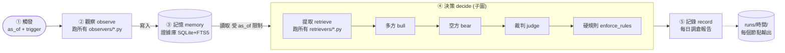
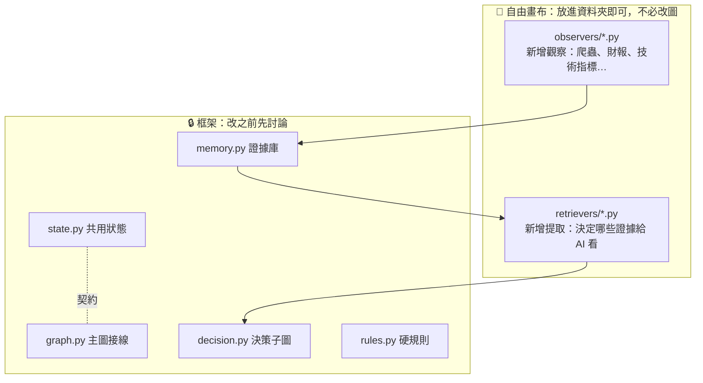
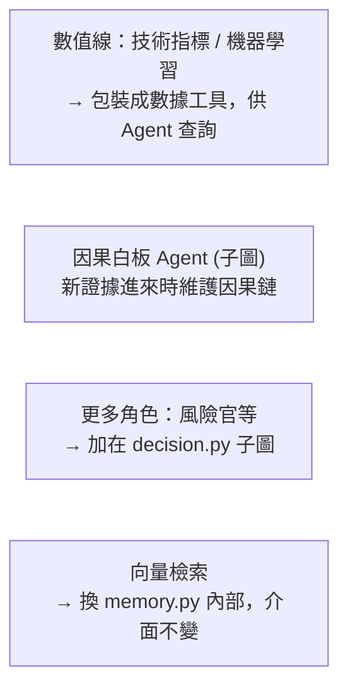

# 脈絡圖 (Map)

> 這張圖是全隊的「地圖」。**改了流程，就要同步改這張圖**（規則見文末）。
> 圖用 Mermaid 寫，GitHub 與 Obsidian 都會自動渲染，改文字就是改圖。

## 一、主圖（永遠只有這幾個節點）

## 二、組員的位置（「畫布」在哪裡）

## 三、資料怎麼流動

| 步驟 | 誰負責 | 輸入 | 輸出 |
|---|---|---|---|
| 觸發 | 排程 / 手動 | — | `as_of`（截至時間）、`trigger`（僅記錄） |
| 觀察 | `observers/` 外掛 | `as_of` | `Evidence` 證據條目 → 寫入證據庫 |
| 記憶 | `memory.py` | Evidence | 三層內容：概要 → 要點 → 原文 |
| 提取 | `retrievers/` 外掛 | `as_of` + 證據庫 | 概要層證據清單 |
| 決策 | `decision.py` | 證據清單 | 多空論述 → 調倉 (trades) |
| 硬規則 | `rules.py` | 調倉 | 被鎖住的調倉（如每日上限 25 次） |
| 記錄 | `graph.py: record` | 全部 | `runs/<時間>/report.md` |

## 四、未來擴充位置（尚未實作，先占位）

## 五、如何維護這張圖（規則）

1. **改流程 = 改圖。** 動了 `graph.py` 或 `decision.py` 的節點或連線，同一個 PR 裡更新上面的 Mermaid。
2. **新增外掛不用改圖。** 放進 `observers/` 或 `retrievers/` 就好；若是很重要的新來源，在「三、資料怎麼流動」補一行說明。
3. **主圖保持精簡。** 新的複雜度一律做成**子圖**收進某個區塊，不要往主圖加節點。
4. **State 是契約。** 新增欄位要在 `state.py` 寫清楚用途與註解，並在 Discord 通知大家。
5. **圖與程式不一致時，以程式為準，然後立刻補圖。**
6. 寫 Mermaid 小提醒：含括號或特殊符號的文字請用雙引號包起來 `A["文字 (說明)"]`，換行用 ` `。
