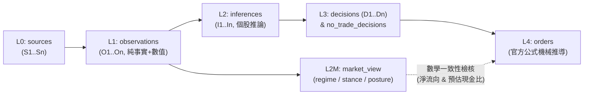
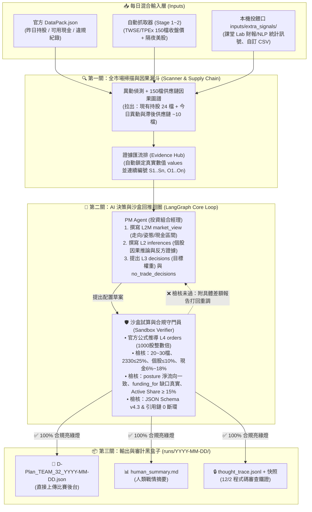

# 系統邊界與決策白板 (System Blueprint & Decision Whiteboard)

> 本文件為**人機協作主幹（Master Control Whiteboard）**。
> 我們透過對談（Grilling Mode）逐一釐清系統邊界、硬性檢核與 AI 決策邏輯，每當達成一項共識，即同步更新此白板與架構圖。

---

## 一、官方規格書（v4.3）硬性邊界總覽

在設計任何 AI 邏輯前，系統受到主辦方伺服器「一票否決」的硬規則限制，一旦違反將導致**整份檔案退回（無法上傳）**或**當日委託整批作廢（`voided`）**：

### 1. 帳戶、部位與營運硬規則（Portfolio & Operational Constraints）
| 規則項目 | 官方硬限制 | 違反後果 / 系統設計對策 |
|---|---|---|
| **標的池限制** (`RULE-AST-01`) | 僅限官方指定的 150 檔標的池（上市 100 檔 `twse`、上櫃 50 檔 `tpex`） | 整批作廢並記警告 |
| **持股檔數** (`RULE-POR-01`) | 成交後須維持 **20 ～ 30 檔**（僅計 `shares > 0`） | 整批作廢並記警告 |
| **個股權重上限** (`RULE-POR-02/03`) | **2330（台積電）≤ 25%**；**其餘個股 ≤ 10%**（分母為 `nav_tradable`） | 加碼超限直接記警告；自然上漲超限有 **5 個交易日緩衝**（第 5 日須強制排程減碼） |
| **現金比例區間** (`RULE-POR-05/06`) | **0% ～ 25%**（嚴禁透支 `< 0`，且不可消極抱現 `> 25%`） | 整批作廢並記警告（須把**買賣手續費 0.1425%** 與**賣出證交稅 0.3%** 及當日 VWAP 波動算入安全緩衝！） |
| **主動投資比率** (`RULE-POR-07`) | 與市售 30 檔主動型 ETF 前 15 大持股比對，**Active Share 須 $\ge 15.0\%$**： $\frac{1}{2}\sum \|W_{i,\text{Agent}} - W_{i,\text{ETF}}\| \ge 15\%$ | **連續 2 日 `< 15%` 直接取消參賽資格 (DQ)** |
| **整股與現股** (`RULE-AST-02/03`) | 委託股數須為 **1000 之正整數倍**，100% 全數以**當日成交均價 (VWAP)** 成交 | 退件或作廢 |
| **提交時段與配額** (`RULE-OPS-01/03/04`) | 每日 **T-1 19:30 ～ T 08:55** 截止（19:00 更新結算 NAV），每日上限 25 次，24 交易日須至少成功繳交 **22 日**，**累計 3 次警告即 DQ** | 逾時未繳記警告 |
| **全自主與留存審計** (`RULE-DEV-01/02/06`) | 「公開說明書」與每日「D-Plan」均須由 **AI Agent 自主產製**，須完整保留 Prompt、推理軌跡（Thought Trace）與 `code_version` 供 12/2 審查 | 人工偽造將取消資格 |

### 2. D-Plan 因果鏈與數學一致性檢核（Chain & Math Integrity）

* **零斷環原則**：`orders` ➔ `decisions` ➔ `inferences` ➔ `observations` ➔ `sources` 必須層層引用真實存在的 ID，流水號從 1 連續遞增不跳號。
* **100% 持股覆蓋率**：昨日 `DataPack` 中所有 `shares > 0` 的持股，今日必須出現在 `decisions`（異動）或 `no_trade_decisions`（續抱），**不漏、不重**。
* **委託公式鎖死**：
  $$\text{目標股數} = \lfloor \frac{\text{target\_weight} \times \text{nav\_tradable}}{\text{close\_price} \times 1000} \rfloor \times 1000$$
  $$\text{委託股數} = \text{目標股數} - \text{目前持有股數}$$
* **姿態承諾一致性（`posture` vs `orders`）**：
  * 宣告 `increase` ➔ 預估買進總額 > 賣出總額。
  * 宣告 `reduce` ➔ 預估賣出總額 > 買進總額。
  * 宣告 `hold` ➔ $|\text{買} - \text{賣}| \le 2\% \times \text{nav\_tradable}$。
  * 預估成交後現金比必須落在 `market_view.posture.target_cash_pct_range` 內。
* **資金調度檢核（`funding_for`）**：若賣出標記 `funding_for: ["D2"]`，則「不執行這些調度賣出時，預估現金比必須真的跌破 `target_cash_pct_range` 下限」，否則視為矛盾退件。

---

## 二、待決議決策樹（Decision Backlog）

我們將依序確認以下 6 個核心設計問題，每確認一題就鎖定一塊架構：

- [x] **決策 1：AI 與 Python 硬邏輯的職責切分（核心邊界）** — **已決議**：採用「具備沙盒試算與自我回推能力的 PM Agent 架構（三階段演進）」。
- [x] **決策 2：可擴充的分析師角色與插槽設計（Sub-Agents & Lab Slots）** — **已決議**：採用「平行分析師插槽 ＋ 統一 `AnalystCard`（來源、客觀事實數字、初步推論）匯流排」。
- [x] **決策 3：公開說明書主題與 150 檔標的池篩選（L0 策略池 + Active Share 防禦）** — **已決議**：「台股雙市場（上市櫃）事件預期差與供應鏈傳導主動 ETF」＋ 上市櫃混血分層配重。
- [x] **決策 4：每日最小必要資料源（L0/L1 資料管線分階段演進）** — **已決議**：官方免 Key 優先，分四階段（Stage 1~4）漸進擴充資料源表。
- [x] **決策 5：首日建倉（0 ➔ 20~30 檔）與日常換股機制（方案 C：異動偵測 + 供應鏈因果圖譜）** — **已決議**：結合全市場統計異動掃描與 150 檔上下游供應鏈圖譜，捕捉龍頭對上櫃供應鏈之滯後預期差。
- [x] **決策 6：上層主幹操控介面、混合資料輸入與全自動稽核軌跡（RULE-DEV-01/02 Audit Trail）** — **已決議**：採用「自動抓基礎行情 ＋ 本機資料夾隨丟隨讀（混合輸入）」＋ 一鍵執行產出 D-Plan 與 12/2 審計黑盒子紀錄。

---

## 三、已確認決策紀錄（Resolved Decisions）

### ✅ 決策 1：具備沙盒試算與自我回推能力的 PM Agent 架構（分三階段演進）

* **核心架構定調**：
  1. **完整賦權給 AI**：市場姿態（`posture`）、個股目標權重（`target_weight`）、以及資金調度（`funding_for`）由 PM Agent 自主根據因果推論決定。
  2. **沙盒試算與回推迴圈（PM Agent ⇄ Sandbox Verifier Loop）**：Python 擔任「下單模擬器與合規守門員（Verifier Node）」。當 PM Agent 提出配置草案後，沙盒立即以官方公式試算張數、現金比、檔數與引用鏈完整性；若不合規，將具體的「差額與違規報告」打回給 PM Agent 重新調整，直到亮綠燈才輸出 `D-Plan.json`。
* **三階段推進路線圖（Phased Rollout）**：
  * **Phase 1（保底生存線 — 最優先打通）**：單一主幹 PM Agent ＋ 沙盒試算回推迴圈 ＋ 基礎行情/現有持股輸入。確保在時間極度有限下，能穩定產出 100% 通過官方 Schema 與數學檢核的 `D-Plan.json`。
  * **Phase 2（專題與組員擴充線 — 插槽化接入）**：將課程 Lab 的「財報分析」、組員討論的「市場指標／情緒分析」做成標準化的**分析師子節點（Analyst Sub-nodes）**，各自產出 `Sources (S)`、`Observations (O)` 與初步 `Inferences (I)` 餵給 PM Agent。
  * **Phase 3（競賽進階深度線 — 時間充裕時升級）**：加入「多空辯論／反方審計員（專攻 `counter_evidence`）」與「昨日復盤反思記憶（Reflection on `prev_day_orders`）」。

### ✅ 決策 2：可擴充的分析師插槽與 `AnalystCard` 標準介面

* **平行分析師層（Analyst Layer）**：在 PM Agent 之前設立可自由增減的分析師插槽（Phase 1 先開「基礎市場價量分析師」，Phase 2 隨時掛載「課程 Lab 財報分析師」與「新聞/指標分析師」）。
* **統一輸出契約（`AnalystCard`）**：每個分析師模組只需回傳包含三要素的結構：
  1. **來源（Source）**：`authority`、`url`、`content_as_of`。
  2. **客觀事實與數值（Fact & Values）**：純事實 `statement` ＋ 至少一個數值鍵值對 `values`（由源頭 Python 鎖定，防止 LLM 幻覺竄改數字）。
  3. **初步推論建議（Draft Inference，選填）**：供下游 PM Agent 綜合裁決。
* **編號匯流排（Evidence Hub）**：自動將所有分析師回傳的卡片去重並連續編號為 `S1..Sn` 與 `O1..On`，無縫接軌下游 PM Agent。

### ✅ 決策 3：公開說明書主題與「上市櫃混血」防撞衫配置（破解 `RULE-POR-07` Active Share $\ge 15\%$）

* **ETF 公開說明書主題設定**：**「台股雙市場（上市櫃）事件預期差與供應鏈傳導主動 ETF」**。
  * **核心投資理念**：捕捉大型權值龍頭（如台積電法說、美股科技巨頭財報、月營收公告）之事件預期差，並透過產業上下游因果鏈，傳導配置至具備高成長彈性的**上櫃（OTC）精銳供應鏈（半導體設備、特用化學、散熱、高速傳輸）与上市中小型績優股**。
  * **合規注意（`RULE-DEV-02` / `RULE-OPS-02`）**：本份公開說明書（10/21～10/26 繳交）**必須由 AI Agent 跑腳本產製**，並完整保存產製時的 Prompt 與 Thought Trace 供日後審計。
* **結構性破解 Active Share $\ge 15\%$（防範與 30 檔主動 ETF 撞衫）**：
  * 官方公式：$\text{Active Share} = \frac{1}{2} \sum |W_{i,\text{Agent}} - W_{i,\text{Benchmark}}| \ge 15\%$（比對前 15 大持股，連 2 日 `< 15%` 直接 DQ）。
  * **硬性配比護欄（免爬蟲數學必勝法 + 靜態快照雙重保護）**：
    1. **數學結構必勝定理**：市售 30 檔主動型 ETF 幾乎全數集中於「上市大型權值股」或「美股科技股」。只要我們的投資組合限制**「所有單一上市大型股權重上限壓在 12% 以內，且強制將 $\ge 35\%$ 的總權重分散配置於上櫃（`tpex`）中小型股」**，在數學上與任何上市大型 ETF 的最大重疊度（Overlap）不可能超過 65%，即 Active Share 恆 $\ge 35\%$（遠高於 15% 紅線）。
    2. **投信公開權重檢核器**：沙盒驗證器內建 30 檔主動型 ETF 的前 15 大持股基準表（可由投信公開頁面或 `twse/fininst` 更新），每次產出 D-Plan 前直接實算 30 組 Active Share 數值並印出最低值，確保 100% 安心。

### ✅ 決策 4：每日資料源的四階段演進表（Stage 1~4 Data Sources Roadmap）

不依賴複雜付費 API Key（FinMind 可選申請免費 Token 當備援，但不強求），優先採用官方免 Key OpenAPI，並分四階段漸進掛載：

| 階段 | 資料源名稱 | D-Plan `authority` | 讀取的核心內容與指標 | 負責支撐的決策層級 | 是否需 API Key |
|---|---|---|---|---|---|
| **Stage 1 （保底必備）** | **TWSE 證交所 OpenAPI** + **TPEx 櫃買中心 OpenAPI** | `twse` / `tpex` | 上市 100 檔與上櫃 50 檔之**前日收盤價（計算 `orders` 公式必填）**、漲跌幅、成交量、本益比 (PE)、殖利率 | L1 個股價量事實、L4 委託張數推導 | ❌ 免 Key |
| **Stage 2 （大盤姿態）** | **隔夜美股與期貨指標** (`yfinance` / 期交所) | `vendor` / `taifex` | 費城半導體 (`^SOX`)、那斯達克 (`^IXIC`)、台積電 ADR (`TSM`)、台指期夜盤漲跌幅 | **L2M `market_view`（必填）** 的 `basis_refs` 與 `regime` 研判 | ❌ 免 Key |
| **Stage 3 （籌碼與基本面）** | **三大法人買賣超 (TWSE/TPEx)** + **MOPS 公開資訊觀測站** | `twse` / `tpex` / `mops` | 外資與投信連續買賣超張數、最新月營收年增率 (YoY) 與財報 EPS 預期差 | L2 個股因果推論（供應鏈動能與財報預期差） | ❌ 免 Key（可選配 FinMind 免費 Key 加速） |
| **Stage 4 （NLP 文本事件）** | **財經新聞 RSS / 鉅亨網重大新聞** + `web.archive.org` | `media` | 150 檔個股相關法說會、訂單、產業新聞文本（搭配課程 Lab 的 NLP / DTM 訊號萃取與 Archive 存檔連結） | L1 事件型觀察、L2 反方證據 (`counter_evidence`) | ❌ 免 Key |

### ✅ 決策 5：首日建倉與日常調倉機制（方案 C：全市場異動偵測 ＋ 150 檔供應鏈因果圖譜）

* **核心機制（A 統計異動雷達 ＋ B 產業供應鏈圖譜）**：
  1. **內建「150 檔上下游供應鏈因果圖譜（Supply Chain Knowledge Graph）」**：將 150 檔個股預先標註其產業聚落與上下游傳導關係（例如：先進封裝 CoWoS 龍頭 2330 ➔ 上櫃設備廠 3131 弘塑、6187 萬潤、3680 家登；AI 伺服器龍頭 2382 廣達/6669 緯穎 ➔ 散熱 3017 奇鋐、3324 雙鴻、川湖 2059 等）。
  2. **第一關：全市場異動雷達（Scanner）**：每日掃描全部 150 檔，偵測「價量突破、法人大買、營收創高或重大新聞」之領頭羊異動股。
  3. **第二關：順著因果鏈拉出「滯後預期差候選股（Focus List ~35 檔）」**：當領頭羊異動時，自動順著供應鏈圖譜拉出「同鏈條但尚未反映漲幅的上櫃/中小型關聯股」，連同**手上既有持股（20~25 檔，規則強制每日必檢）**組成約 35 檔之今日焦點名單，送入 PM Agent（完美控制在 Schema 的 `observations <= 100`、`inferences <= 60` 上限內）。
* **首日建倉（Day 1）與日常換股（Day 2~24）參數**：
  * **Day 1 首日建倉**：從主流供應鏈聚落中挑選 **24 檔（約 13~14 檔上市 + 10~11 檔上櫃）**，總目標股票權重約 **85%（預留 15% 現金緩衝手續費 0.1425% 與隔日 VWAP 波動）**。
  * **Day 2~24 日常微調（低週轉率保護成本）**：多數持股歸入 `no_trade_decisions`（續抱並附推論引用），每日僅針對 **1～4 檔** 出現顯著預期差、趨勢轉弱、或**自然上漲超標達第 4~5 日（`RULE-POR-04` 5 日緩衝期強制減碼）**之個股進行換股或加減碼。

### ✅ 決策 6：上層主幹操控介面、混合資料輸入與全自動稽核軌跡（Audit Trail）

* **工具提供與資料輸入邊界（混合式輸入）**：
  1. **Python 工具與模型由人類工程師提供**：所有爬蟲、課堂 Lab 的統計/NLP 訊號模型、供應鏈圖譜查詢與沙盒試算器，皆由我們預先寫成標準 Python 模組或 `@tool` 供系統與 AI 使用。
  2. **保底自動抓取 ＋ 開放本機投餵口（`inputs/extra_signals/`）**：系統每日自動抓取必備之 TWSE/TPEx 收盤價與美股指標；同時開放本機資料夾，支援隨時丟入外部整理好的 CSV/JSON/財報訊號（只要包含公開 `url` 與 `authority`），Agent 啟動時自動吸收並轉為合法的 `S` 與 `O`。
* **一鍵執行與 12/2 審查黑盒子（`runs/<trade_date>_<timestamp>/`）**：
  * 每次執行自動產出並留存 4 份檔案：
    1. `D-Plan_<team_id>_<trade_date>.json`（100% 通過官方 Schema 與數學驗算的最終上傳檔）。
    2. `human_summary.md`（給人類看的中文戰情白話報告：今日雷達異動、供應鏈傳導、買賣張數、預估現金比與 Active Share 數值）。
    3. `thought_trace.jsonl`（完整留存 Prompt、LLM 原始回覆、沙盒回推重試紀錄、Token 用量與 `code_version`，完全滿足 `RULE-DEV-01/02/06` 審查要求）。
    4. `source_snapshots/`（當日外部資料原始快照，供抽檢對帳）。

---

## 四、最終系統主幹架構圖（LangGraph Master Architecture）

